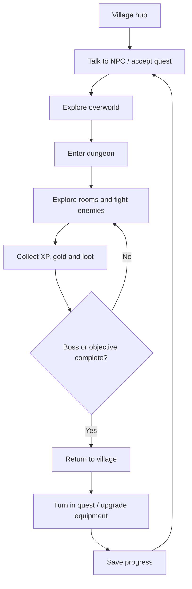
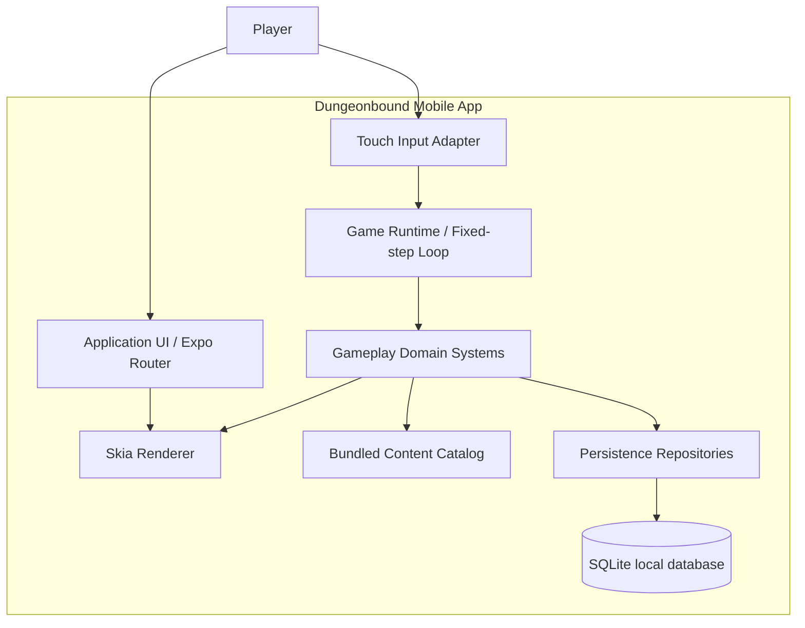
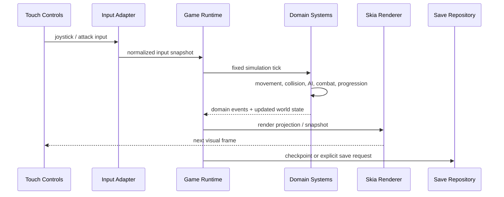

# Dungeonbound: The Lost Realm

> **Project architecture and implementation specification**  
> Status: Architecture baseline for the offline-first single-player release  
> Platform: Android first, iOS-compatible architecture  
> Orientation: Landscape  
> Genre: 2D top-down action RPG / dungeon crawler  
> Working title: **Dungeonbound**

---

## 1. Product vision

Build a polished, offline-first, 2D top-down fantasy action RPG for mobile. The player explores a small interconnected fantasy world, visits a safe hub, accepts quests, enters dungeons, fights enemies, collects equipment, earns experience, and unlocks new areas.

The first release is **single-player only**. It must be fully playable with the device in airplane mode after installation. Multiplayer is a later product phase, not a dependency of the first release.

The codebase must keep gameplay rules independent from React Native UI, rendering, storage, and future networking. This creates clean extension points without building premature multiplayer infrastructure.

### 1.1 Player fantasy

The player is an adventurer investigating a corrupted realm. The first playable slice should communicate a complete mini-adventure:

1. Start in a safe village.
2. Speak to an NPC and accept a quest.
3. Travel to a nearby dungeon entrance.
4. Explore rooms, fight enemies, and collect loot.
5. Defeat a mini-boss and obtain a quest item.
6. Return to the village, turn in the quest, receive rewards, and save progress.

### 1.2 Product principles

- **Offline-first:** no login, backend, or connection required to play the first release.
- **Game-first:** movement, combat, feedback, and progression must be enjoyable before adding large quantities of content.
- **Mobile-native:** landscape layout, touch-friendly controls, pause/resume support, and performance on mid-range Android devices.
- **Data-driven content:** maps, items, enemies, quests, and balance values should be authored as content data instead of being hard-coded into UI components.
- **Small vertical slices:** every phase must leave the game in a runnable state.
- **Multiplayer-ready boundaries, not multiplayer implementation:** use commands, events, stable entity IDs, and repository interfaces; do not add sockets, Bluetooth, accounts, or a backend in v1.

---

## 2. Scope and release boundaries

### 2.1 V1: offline single-player

V1 includes:

- Android-first mobile application, with iOS support considered in dependency choices.
- One playable hero archetype initially. The data model must allow additional classes later.
- 2D top-down tile-based world.
- Landscape orientation.
- Four-direction movement initially; diagonal movement may be enabled after animation and collision are stable.
- Camera follow, map boundaries, solid tiles, and object collision.
- Real-time basic melee combat.
- Enemy AI with idle, patrol, chase, attack, hurt, and defeated states.
- Player health, damage, cooldowns, knockback, and temporary invulnerability.
- XP, levels, basic attributes, equipment, and inventory.
- A village hub, one outdoor route, and one small dungeon for the first playable release.
- NPC interaction and a small quest chain.
- Local SQLite saves with multiple save slots or a clearly designed single-slot model. Prefer two or three save slots if implementation cost is low.
- Settings for sound, music, vibration, and control sensitivity.
- Bundled art, maps, audio, and game definitions.
- No internet permission or network dependency required for the core game loop unless a future Expo update check is configured.

### 2.2 Explicitly out of scope for V1

Do not implement these unless the user explicitly changes the scope:

- Bluetooth, Wi-Fi Direct, LAN, peer-to-peer, or online multiplayer.
- Matchmaking, lobbies, accounts, cloud saves, guilds, trading, PvP, or chat.
- A server or database hosted in Azure.
- Ads, in-app purchases, telemetry, analytics, or login.
- Massive open world, MMO architecture, or complex real-time simulation.
- Procedural generation for every map. Start with authored maps; procedural dungeon generation can be a later enhancement.
- A large class roster, crafting economy, complex skill trees, or hundreds of items.
- Live downloadable content packs. All V1 maps and content must ship inside the app.

### 2.3 Recommended first release content target

Keep the first game compact and finishable:

| Content | Initial target |
|---|---:|
| Hero archetypes | 1 playable archetype; data model supports more |
| Hub | 1 village |
| Overworld areas | 1 small connected area |
| Dungeons | 1 dungeon, approximately 8–12 rooms |
| Normal enemy types | 3 |
| Mini-bosses | 1 |
| NPCs | 3–5 |
| Main quest chain | 3–5 quests |
| Items | 15–25 |
| Equipment slots | Weapon, head, body, accessory |
| Level range | 1–10 for the first content slice |

These are planning targets, not requirements to fill the game with low-quality content. Prioritize a complete and enjoyable loop.

---

## 3. User experience and gameplay design

### 3.1 Primary gameplay loop



### 3.2 Screens and navigation

Use Expo Router for application-level navigation. The actual real-time game scene is a dedicated full-screen route and must not be rebuilt on every simulation tick.

Required screens:

1. **Boot** — initialize local database, apply migrations, validate bundled content, load settings.
2. **Main menu** — New Game, Continue, Load Game, Settings, Credits.
3. **Save selection** — create, continue, rename if supported, and delete saves with confirmation.
4. **Gameplay** — Skia game canvas, touch controls, health/XP HUD, interaction prompt.
5. **Pause** — Resume, Settings, Save/Return to Menu.
6. **Inventory** — item list, equipment, item details, equip/use actions.
7. **Character** — level, stats, equipment summary, unlocked abilities.
8. **Quest log** — active and completed quests.
9. **Dialogue** — NPC dialogue and quest choices.
10. **Settings** — audio, vibration, control layout/sensitivity, accessibility options.
11. **Game over / respawn** — restart from last checkpoint with clearly defined penalty or no penalty for the first prototype.

### 3.3 Mobile controls

Landscape layout:

- Left side: virtual joystick or directional pad.
- Right side: primary attack, dodge/secondary action, interact.
- HUD: health, XP/level, current objective, optional minimap later.
- Pause button remains reachable without overlapping gameplay controls.

Control design rules:

- Controls must support different screen aspect ratios and safe areas.
- Do not rely on tiny hit targets.
- Support a configurable joystick dead zone and sensitivity.
- Pause simulation when the app backgrounds or the player opens a blocking system modal.
- Provide a settings option to switch joystick and directional-pad layouts if practical.

### 3.4 Combat baseline

Implement a small, understandable action-combat system first:

- Player attack is an input command with an attack cooldown and an active hit window.
- Attack hitboxes are calculated in world space, based on facing direction and attack definition.
- Only valid targets inside the hitbox receive damage.
- Damage is computed in the domain layer, not in a UI component.
- Enemies can have attack wind-up and recovery states so attacks are readable.
- Player and enemies support health, damage, knockback, and brief invulnerability frames.
- Loot and XP are granted through domain events after an enemy is defeated.
- No physics engine is needed for V1; use grid/tile collision plus simple AABB/circle overlap tests.

### 3.5 Initial enemy AI

Use a finite-state machine per enemy rather than putting behavior in React components.

States:

- `idle`: remains still or waits.
- `patrol`: moves between authored waypoints or a small patrol radius.
- `chase`: follows the player inside an aggro radius.
- `attack`: starts an attack when in range and cooldown is ready.
- `hurt`: short hit reaction / knockback.
- `dead`: no longer acts; may produce loot and XP once.

The first enemy implementation should have clear state transitions and be testable without rendering.

---

## 4. Technology stack

Use versions compatible with the selected Expo SDK. Do not manually pin React Native, React, Expo modules, Skia, Reanimated, or Worklets to unrelated versions. Use `npx expo install` for Expo-managed dependencies and inspect the installed package types before using newer APIs.

| Layer | Choice | Why |
|---|---|---|
| Framework | React Native + Expo | Mobile application foundation and native build tooling |
| SDK baseline | Expo SDK 58 / React Native 0.88 / React 19.3 | Current documented baseline when this architecture was prepared; use the compatible Expo template and re-check package versions when scaffolding |
| Language | TypeScript, strict mode | Safer domain contracts and refactoring |
| Rendering | `@shopify/react-native-skia` (Expo SDK 58 reference: 2.14.0) | 2D canvas, sprites, tile layers, effects |
| UI animation | `react-native-reanimated` (SDK 58 reference: 4.7.1) + `react-native-worklets` where needed | UI transitions and animation coordination; not the game-state database |
| Navigation | Expo Router (SDK 58 reference: ~58.0.32) | Menu, settings, inventory, and route organization |
| UI state | Zustand | Menus, settings, selected inventory item, non-frame UI state |
| Persistence | `expo-sqlite` (SDK 58 reference: ~58.0.18) | Structured local data and durable save files |
| Simple preferences | SQLite tables or `expo-sqlite/kv-store` | Small local preferences; avoid maintaining duplicate stores |
| Input | React Native touch responders / Gesture Handler if required | Virtual joystick and action controls |
| Map authoring | Tiled Map Editor, exporting JSON | Authored tile maps and object layers |
| Pixel-art authoring | Aseprite or LibreSprite | Spritesheets, tile sets, animation frames |
| Content validation | Zod (optional but recommended) | Validate JSON content definitions at load/build time |
| Unit tests | Jest + `jest-expo` | Test domain logic and application modules |
| UI tests | React Native Testing Library | Test menu and HUD interactions |
| E2E smoke tests | Maestro (optional) | Test boot, save/load, offline launch, and navigation on device |
| Static quality | TypeScript, ESLint, Prettier | Type safety and consistent code |
| Native builds | EAS Build / local native builds | Development and release binaries |
| OTA | EAS Update | Ship compatible JS and bundled-asset updates |

### 4.1 Development environment

- Node.js version supported by the selected Expo SDK.
- npm or pnpm; choose one package manager and commit its lockfile.
- Android Studio and Android emulator for local testing.
- A physical Android device for touch, performance, lifecycle, and offline testing.
- Expo development build (`expo-dev-client`) for production-oriented development. Expo Go may be useful for early experiments, but do not depend on it as the only test environment.

### 4.2 Why no game-engine framework initially?

The project is deliberately a small 2D mobile RPG. Skia plus a focused TypeScript simulation layer is sufficient to build the initial renderer and game loop while keeping the app inside React Native. Do not add a full ECS framework, physics engine, or separate game engine until profiling or feature requirements justify it.

If Skia-based rendering becomes a bottleneck or the game scope expands into complex physics, reevaluate a dedicated engine as an explicit architecture decision rather than quietly mixing two rendering systems.

---

## 5. High-Level Design (HLD)

### 5.1 System context

V1 has one installed mobile application. All playable content and persistent progress are local. No API server is required.



### 5.2 Logical layers

#### A. Presentation layer

Responsibilities:

- Expo Router navigation and application screens.
- Main menu, inventory, character sheet, quest log, dialogue, settings, pause menu.
- Touch control visuals and control layout.
- HUD projections such as health, XP, and current objective.

Rules:

- Presentation components do not implement combat, collision, enemy AI, rewards, or persistence rules.
- Do not call `setState` on every frame.
- Screens ask application services to execute actions; they do not write SQL directly.

#### B. Rendering layer

Responsibilities:

- Draw tile maps, sprites, effects, health bars, and world-space UI through Skia.
- Convert world coordinates to camera/screen coordinates.
- Cull entities and map chunks outside the viewport.
- Choose sprite animation frames from the render snapshot.

Rules:

- Rendering is a read-only view of game state.
- Renderer must not decide whether an attack hits, whether an enemy dies, or how much XP is granted.
- Keep pixel-art filtering consistent and avoid scaling sprites to arbitrary fractional pixel sizes where possible.

#### C. Input layer

Responsibilities:

- Read virtual joystick / D-pad and action buttons.
- Convert gestures into normalized input snapshots or domain commands.
- Apply control dead zones and prevent duplicate touch actions.

Rules:

- Input layer does not directly mutate enemy or player objects.
- Inputs are passed to the runtime as commands or a per-tick input snapshot.

#### D. Game application / runtime layer

Responsibilities:

- Own the active `GameSession`.
- Start, pause, resume, and stop the simulation.
- Run the fixed-step update loop.
- Route commands to domain systems.
- Publish immutable or safely copied render/UI projections at a controlled cadence.
- Coordinate checkpoints and save requests.

#### E. Domain / simulation layer

Responsibilities:

- Player movement and stats.
- Collision and world boundaries.
- Combat, damage, invulnerability, knockback, and cooldowns.
- Enemy AI state machines.
- XP, levels, items, equipment, and loot.
- Quests, NPC interactions, and world flags.
- Death, respawn, and checkpoint rules.

Rules:

- Pure TypeScript where possible.
- No imports from React, React Native, Skia, Expo, SQLite, or network libraries.
- Use stable IDs and explicit domain events.
- Domain logic must be unit-testable in a Node/Jest environment.

#### F. Infrastructure layer

Responsibilities:

- SQLite initialization and migrations.
- Save/load repository implementations.
- Bundled asset/content loading.
- File import/export for saves only if added later.

Rules:

- Database access is hidden behind repository interfaces.
- The domain layer must not know SQL table names.

### 5.3 Runtime data flow



### 5.4 Game loop

Use a fixed-step simulation with a variable render cadence:

- Target simulation step: 1/60 second.
- Use `requestAnimationFrame` or a suitable frame scheduler while the gameplay screen is active.
- Accumulate elapsed time and run zero or more fixed updates per rendered frame.
- Clamp unusually large frame deltas after app suspension; do not simulate minutes of combat after the app resumes.
- Cap catch-up steps to avoid a spiral of death.
- Pause the simulation when the app backgrounds, a blocking menu is open, or the player pauses.
- Do not call React component state setters 60 times per second.
- Keep hot-path allocations low; reuse arrays/objects where practical after profiling.

Illustrative pseudocode (adapt to the actual selected Skia/Reanimated integration):

```ts
const STEP_SECONDS = 1 / 60;
const MAX_FRAME_SECONDS = 0.1;
const MAX_CATCH_UP_STEPS = 5;

let previousTime = 0;
let accumulator = 0;

function onFrame(nowMs: number) {
  const now = nowMs / 1000;
  const rawDelta = previousTime === 0 ? 0 : now - previousTime;
  previousTime = now;

  if (session.isPaused) return scheduleNextFrame(onFrame);

  accumulator += Math.min(rawDelta, MAX_FRAME_SECONDS);
  let steps = 0;

  while (accumulator >= STEP_SECONDS && steps < MAX_CATCH_UP_STEPS) {
    runtime.update(STEP_SECONDS, inputAdapter.readSnapshot());
    accumulator -= STEP_SECONDS;
    steps += 1;
  }

  renderer.publish(runtime.createRenderSnapshot());
  scheduleNextFrame(onFrame);
}
```

This is architectural pseudocode, not a demand to use a particular hook API. The implementation must follow the installed Skia/Reanimated version's documented APIs.

### 5.5 World coordinate model

- Use a fixed logical tile size, initially 16×16 or 32×32 world pixels; choose one after testing the selected art style.
- Keep world coordinates independent from physical device pixels.
- Keep the camera transform separate from entity positions.
- Store maps as layers: ground, decoration, collision, foreground, and object/spawn points.
- Only draw visible map tiles and entities within the camera viewport plus a small margin.
- Map transitions should load the next authored map definition from bundled content.

### 5.6 Entity and system model

Use a lightweight data-oriented model rather than adopting a full ECS framework prematurely.

Core runtime entities:

- `PlayerEntity`
- `EnemyEntity`
- `NpcEntity`
- `PickupEntity`
- `WorldObjectEntity`

Core systems:

- `InputSystem`
- `MovementSystem`
- `CollisionSystem`
- `EnemyAISystem`
- `CombatSystem`
- `InteractionSystem`
- `LootSystem`
- `ProgressionSystem`
- `QuestSystem`
- `WorldStateSystem`

Systems receive the session/world data they need and update it in a documented order. Avoid hidden global state.

Recommended update order:

1. Consume player input.
2. Resolve player movement intent.
3. Update enemy AI intent.
4. Integrate movement.
5. Resolve tile and entity collisions.
6. Advance attack timers and hit windows.
7. Resolve hit detection and damage.
8. Resolve enemy death and loot.
9. Resolve XP, quest progress, and world flags.
10. Emit domain events and build render/UI projections.

---

## 6. Low-Level Design (LLD)

### 6.1 Suggested domain contracts

Create these as TypeScript types/interfaces. Names can evolve, but preserve the boundaries.

```ts
export type EntityId = string;
export type MapId = string;
export type ItemId = string;
export type QuestId = string;

export interface Vector2 {
  x: number;
  y: number;
}

export interface Transform {
  position: Vector2;
  facing: 'up' | 'down' | 'left' | 'right';
}

export interface Health {
  current: number;
  maximum: number;
}

export interface PlayerProfile {
  id: string;
  displayName: string;
  level: number;
  experience: number;
  experienceToNextLevel: number;
  baseStats: PlayerStats;
  unlockedAbilities: string[];
}

export interface PlayerStats {
  maxHealth: number;
  attack: number;
  defense: number;
  moveSpeed: number;
  criticalChance: number;
}

export interface GameSession {
  saveSlotId: string;
  mapId: MapId;
  worldSeed: number;
  player: PlayerEntity;
  enemies: Map<EntityId, EnemyEntity>;
  npcs: Map<EntityId, NpcEntity>;
  pickups: Map<EntityId, PickupEntity>;
  worldFlags: Record<string, boolean | number | string>;
  questState: QuestState;
  elapsedGameTimeMs: number;
}

export type GameCommand =
  | { type: 'MOVE'; direction: Vector2 }
  | { type: 'ATTACK' }
  | { type: 'DODGE' }
  | { type: 'INTERACT'; targetId: EntityId }
  | { type: 'USE_ITEM'; inventoryItemId: string }
  | { type: 'EQUIP_ITEM'; inventoryItemId: string }
  | { type: 'ACCEPT_QUEST'; questId: QuestId }
  | { type: 'PAUSE' }
  | { type: 'RESUME' };

export type GameEvent =
  | { type: 'PLAYER_DAMAGED'; amount: number; sourceId?: EntityId }
  | { type: 'ENEMY_DEFEATED'; enemyId: EntityId; xpReward: number }
  | { type: 'ITEM_DROPPED'; itemId: ItemId; position: Vector2 }
  | { type: 'ITEM_COLLECTED'; itemId: ItemId }
  | { type: 'LEVEL_UP'; newLevel: number }
  | { type: 'QUEST_OBJECTIVE_UPDATED'; questId: QuestId }
  | { type: 'MAP_TRANSITION_REQUESTED'; mapId: MapId }
  | { type: 'PLAYER_DIED' };
```

Do not blindly copy this sample if a better aggregate structure emerges. Keep the domain types explicit, serializable where persisted, and independent of UI libraries.

### 6.2 Input model

Use two types of inputs:

- **Continuous input snapshot:** movement vector and held-state buttons, sampled by the simulation loop.
- **Discrete command:** attack pressed, interact pressed, use item, accept quest, equip item, pause.

Example:

```ts
export interface InputSnapshot {
  moveX: number; // normalized -1..1
  moveY: number; // normalized -1..1
  attackHeld: boolean;
  dodgePressed: boolean;
  interactPressed: boolean;
}
```

The input adapter translates device gestures into this shape. Domain systems do not access touch events.

### 6.3 Movement and collision

- Convert normalized input into intended velocity using player speed.
- Normalize diagonal movement so diagonal movement is not faster than cardinal movement.
- Resolve X and Y movement separately or use swept AABB if tunneling appears at the selected speed.
- Resolve against collision tiles and solid world objects.
- Keep collision shapes separate from rendered sprite dimensions.
- Add a small collision box around the character's feet rather than using the entire sprite rectangle; this is generally more natural for top-down movement.
- Unit-test map boundaries, corners, walls, and narrow corridors.

### 6.4 Combat model

Suggested attack definition:

```ts
export interface AttackDefinition {
  id: string;
  damageMultiplier: number;
  startupMs: number;
  activeMs: number;
  recoveryMs: number;
  cooldownMs: number;
  range: number;
  hitboxWidth: number;
  knockback: number;
}
```

For each attack:

1. Validate that the actor can attack.
2. Start the attack state and timer.
3. Wait for startup frames.
4. Activate a directional hitbox for the active window.
5. Apply damage once per target per attack instance.
6. Apply knockback / hit reaction.
7. Enter recovery and then return to idle.

Damage formula should be simple for V1 and centralized. Example: `max(1, attackPower - floor(defense * 0.5))`, then add a bounded critical multiplier if critical hits are implemented. Keep all balance constants in content/config data.

### 6.5 Progression

- XP rewards come from enemy defeat and quest completion.
- Level-up thresholds are data-driven.
- Level-up applies stat growth through one central progression service.
- Equipment bonuses are calculated from base stats plus equipped item modifiers.
- Do not store duplicated derived stats unless there is a compelling reason; compute them from base stats and equipment.
- Handle overflow XP if one reward crosses multiple levels.

### 6.6 Inventory and equipment

V1 inventory requirements:

- Stackable consumables and resources.
- Non-stackable equipment.
- Item rarity enum: common, uncommon, rare, epic, legendary (initial content may only use first three).
- Equipment slots: weapon, head, body, accessory.
- Equip/unequip validation.
- Item usage validation and effect application.
- Inventory capacity can be fixed (for example, 30 slots) or unlimited by stack count for the first prototype. Choose one and make it explicit in the UI.

Item definitions are immutable content data. Player-owned item quantities and equipment selections are save data.

### 6.7 Quest model

Quest definitions are bundled content:

```ts
export interface QuestDefinition {
  id: QuestId;
  title: string;
  description: string;
  giverNpcId: EntityId;
  objectives: QuestObjectiveDefinition[];
  rewards: QuestRewardDefinition[];
  prerequisites?: QuestId[];
}
```

Quest progress is player save data. Objective progress updates through domain events (enemy defeated, item collected, NPC interacted, location entered), not direct UI mutations.

### 6.8 Content definitions

Store content in versioned JSON/TypeScript data modules:

- Maps and spawn points.
- Tile collision layers.
- NPC definitions and dialogues.
- Enemy stats, AI parameters, attacks, and loot tables.
- Item definitions and stat modifiers.
- Quest definitions and rewards.
- Level progression and balance tables.

Every content record has a stable ID. Validate content when the app boots in development and through automated tests in CI. Avoid downloading game-critical content from the network in V1.

### 6.9 Save and load model

**SQLite is the durable source of truth for player progress.** The active game session is in-memory while playing. Saving serializes a consistent snapshot and writes it in a database transaction.

Suggested tables:

| Table | Purpose |
|---|---|
| `save_slots` | Slot ID, display name, created/updated timestamps, save format version |
| `player_state` | Level, XP, current HP, map ID, world position, facing, currency, play time |
| `player_stats` | Base stats or stat allocation if the game supports it |
| `inventory_items` | Owned item IDs, quantities, unique instance IDs, durability if required |
| `equipped_items` | Equipment slot to owned item instance mapping |
| `quest_progress` | Accepted/completed quest state and objective counters |
| `world_flags` | Boss defeated, chest opened, door unlocked, one-time event flags |
| `discovered_locations` | Optional discovery state for map/fast-travel features |
| `settings` | Audio and control preferences if not using SQLite KV store |

Use primary keys and foreign keys where appropriate. Add indexes only for real query patterns. Use parameterized SQL statements for all user/data values.

Save requirements:

- Use database migrations with a schema version (`PRAGMA user_version` or an explicit migrations table).
- Save through a transaction so the player state and inventory cannot become partially updated.
- Never write a database row for each frame or movement update.
- Save on explicit save action, map transitions, quest completion, boss defeat, important item/equipment changes, and controlled autosave checkpoints.
- Debounce non-critical save requests and serialize them so two snapshots cannot race.
- On app background, request a best-effort save; do not depend on background callbacks as the only save guarantee.
- On load, validate the save format version, referenced content IDs, map ID, and numeric bounds.
- If a save is corrupt or from an unsupported format, preserve the original record for recovery where possible and show a useful error; never silently overwrite it with a new game.
- Add an explicit delete-save confirmation.

Do not make a local save appear tamper-proof. V1 has no server authority; a technically capable user may edit local files. This is acceptable for offline single-player.

### 6.10 App lifecycle and offline behavior

Boot sequence:

1. Load app configuration and local bundled content.
2. Open SQLite database.
3. Apply migrations.
4. Validate content index and save metadata.
5. Load local settings.
6. Display main menu without waiting for any API call.

Offline requirements:

- Game launch, new game, continue, map loading, combat, inventory, quests, and saving work in airplane mode.
- No remote images, fonts, map files, or sound files are required by the active game.
- No authentication flow or connectivity gate exists in V1.
- If an OTA update check is enabled, it must be non-blocking. A cached/embedded compatible application bundle must remain playable without internet.
- If the app is interrupted, resume from the latest durable checkpoint/snapshot, not from assumptions about a live JavaScript process.

### 6.11 Error handling

- Database initialization failure: show a recoverable error screen; do not start a new save over an unreadable existing database.
- Content validation failure: fail fast in development; show a controlled startup error in release.
- Missing sprite/audio asset: log a development diagnostic and render a safe placeholder; never crash the gameplay loop.
- Invalid map transition: stay on the current map and emit a diagnostic event.
- Save failure: inform the player and retain the active in-memory session; retry only through a controlled save request.
- Unexpected runtime error: pause safely and offer return to menu; capture a local diagnostic without requiring network access.

---

## 7. Persistence architecture and offline-first rules

### 7.1 Source-of-truth rules

- **Bundled content:** immutable definitions of maps, items, enemies, quests, and art.
- **In-memory session:** current simulation state during active play.
- **SQLite:** durable player-owned state and save snapshots.
- **Zustand:** UI preferences and transient screen state only; not a second source of truth for player progression.

### 7.2 Repository interfaces

Domain/application code should depend on interfaces such as:

```ts
export interface SaveRepository {
  listSlots(): Promise<SaveSlotSummary[]>;
  createSlot(input: CreateSaveSlotInput): Promise<string>;
  loadSlot(slotId: string): Promise<LoadedSaveSnapshot>;
  saveSnapshot(slotId: string, snapshot: SaveSnapshot): Promise<void>;
  deleteSlot(slotId: string): Promise<void>;
}

export interface ContentRepository {
  getMap(mapId: MapId): MapDefinition;
  getEnemy(enemyId: string): EnemyDefinition;
  getItem(itemId: ItemId): ItemDefinition;
  getQuest(questId: QuestId): QuestDefinition;
}
```

The SQLite implementation belongs in the infrastructure layer. Bundled JSON/TypeScript definitions implement the content repository. The domain layer must not import Expo SQLite.

### 7.3 Save snapshot consistency

Create a `SaveSnapshot` from a stable point in the simulation, ideally at the end of a fixed update or while simulation is paused. Include:

- Save format version.
- Player state.
- Current map and world position.
- Inventory and equipped item instances.
- Quest progress.
- World flags and persistent pickups/chests.
- Play time and last saved timestamp.

Write all relevant rows in one SQLite transaction. Add tests that simulate interruption/failure and verify that the previous complete save remains readable.

---

## 8. Future multiplayer compatibility (design only; do not implement in V1)

The future goal may include Bluetooth or Wi-Fi local co-op and online play, but the first release remains fully single-player.

Prepare for future multiplayer by following these rules now:

1. Gameplay logic is in a renderer-independent domain module.
2. Player actions are expressed as `GameCommand` values.
3. Important outcomes are emitted as `GameEvent` values.
4. Entities, items, maps, quests, and world objects use stable IDs.
5. Game content has explicit version identifiers.
6. Random generation, if introduced, accepts and persists a world seed.
7. Repositories are behind interfaces.
8. Input source is abstracted so a future local/remote player input can be represented without the domain depending on touch events.

Do **not** implement a network abstraction framework just for hypothetical use. The eventual multiplayer design should make an explicit choice between host-authoritative local co-op and server-authoritative online sessions. Competitive online play must not trust client-side results. Bluetooth is not a good default for fast real-time combat; begin future nearby multiplayer with Wi-Fi/LAN unless testing demonstrates a Bluetooth mode is suitable.

Future multiplayer will require a separate architecture review for:

- Host migration or host disconnect behavior.
- Command validation and sequence numbers.
- State snapshots and reconciliation.
- Network latency and reconnect behavior.
- Persistent inventory and anti-duplication rules.
- Server authority for online rewards and progression.

---

## 9. OTA and release strategy

Use EAS Update only for compatible JavaScript bundle and asset updates. Treat OTA as a delivery mechanism, not as a requirement for playing the game.

Recommended environments/channels:

- `development` — developer builds.
- `preview` — internal test builds.
- `production` — store builds.

Rules:

- Configure `runtimeVersion` and update channels.
- Keep OTA updates compatible with the native runtime.
- Test an update on a preview build before production rollout.
- Do not block startup waiting for an update download.
- Keep the embedded bundle and already downloaded assets usable offline.
- Native module changes, native permissions, app configuration changes that affect native code, or Expo SDK upgrades require a new native binary. OTA cannot replace that build.
- Avoid shipping a large world expansion solely as an OTA payload; keep V1 content bundled and evaluate downloadable content separately later.

---

## 10. Suggested repository structure

Use a feature-oriented structure with strict separation between app UI, game domain, rendering, content, and infrastructure.

```text
dungeonbound/
├── app/                              # Expo Router routes
│   ├── _layout.tsx
│   ├── index.tsx                     # Boot / main-menu entry
│   ├── menu/
│   │   ├── index.tsx
│   │   ├── saves.tsx
│   │   └── settings.tsx
│   └── game/
│       ├── [saveSlotId].tsx
│       ├── inventory.tsx
│       ├── character.tsx
│       ├── quests.tsx
│       └── pause.tsx
├── assets/
│   ├── sprites/
│   │   ├── player/
│   │   ├── enemies/
│   │   ├── npcs/
│   │   └── effects/
│   ├── tilesets/
│   ├── maps/
│   ├── audio/
│   ├── fonts/
│   └── ui/
├── src/
│   ├── app/                          # App bootstrap and providers
│   ├── ui/                           # Reusable menus, HUD, controls
│   │   ├── components/
│   │   ├── screens/
│   │   └── theme/
│   ├── game/
│   │   ├── domain/
│   │   │   ├── entities/
│   │   │   ├── value-objects/
│   │   │   ├── commands/
│   │   │   ├── events/
│   │   │   └── rules/
│   │   ├── engine/
│   │   │   ├── GameRuntime.ts
│   │   │   ├── GameLoop.ts
│   │   │   ├── GameSession.ts
│   │   │   └── SystemScheduler.ts
│   │   ├── systems/
│   │   │   ├── InputSystem.ts
│   │   │   ├── MovementSystem.ts
│   │   │   ├── CollisionSystem.ts
│   │   │   ├── EnemyAISystem.ts
│   │   │   ├── CombatSystem.ts
│   │   │   ├── InteractionSystem.ts
│   │   │   ├── LootSystem.ts
│   │   │   ├── ProgressionSystem.ts
│   │   │   └── QuestSystem.ts
│   │   ├── world/
│   │   │   ├── World.ts
│   │   │   ├── MapDefinition.ts
│   │   │   ├── TileMapParser.ts
│   │   │   ├── CollisionGrid.ts
│   │   │   └── Camera.ts
│   │   ├── content/
│   │   │   ├── ContentRepository.ts
│   │   │   ├── validators/
│   │   │   └── definitions/
│   │   └── application/
│   │       ├── GameSessionService.ts
│   │       ├── SaveGameService.ts
│   │       └── GameProjection.ts
│   ├── rendering/
│   │   ├── GameCanvas.tsx
│   │   ├── SceneRenderer.ts
│   │   ├── SpriteAtlas.ts
│   │   ├── SpriteAnimator.ts
│   │   ├── CameraRenderer.ts
│   │   ├── TileLayerRenderer.ts
│   │   └── effects/
│   ├── input/
│   │   ├── TouchInputAdapter.ts
│   │   ├── VirtualJoystick.tsx
│   │   └── ControlLayout.tsx
│   ├── platform/
│   │   ├── persistence/
│   │   │   ├── database.ts
│   │   │   ├── migrations/
│   │   │   ├── SqliteSaveRepository.ts
│   │   │   └── SettingsRepository.ts
│   │   ├── lifecycle/
│   │   └── diagnostics/
│   ├── state/                        # Zustand UI-only stores
│   ├── hooks/
│   ├── utils/
│   └── types/
├── tests/
│   ├── unit/
│   ├── integration/
│   └── fixtures/
├── docs/
├── .github/workflows/
├── app.config.ts
├── eas.json
├── tsconfig.json
├── eslint.config.js
├── package.json
└── README.md
```

Do not create empty directories for every future feature immediately. Add modules when a phase needs them, but preserve the architectural boundaries.

---

## 11. Phase-by-phase implementation plan

Every phase ends with a runnable build, tests, and a short demo/checklist. Do not start a new phase while the current phase has broken acceptance criteria.

### Phase 0 — Project foundation and technical spike

**Goal:** establish a clean Expo project and verify the selected rendering/storage technology on a real Android device.

Tasks:

- Create the Expo TypeScript app using the current compatible SDK template.
- Configure strict TypeScript, ESLint, Prettier, path aliases, and environment-independent app config.
- Add Expo Router.
- Add Skia and Expo SQLite using `npx expo install`.
- Add `expo-dev-client` and create a development build when needed.
- Set landscape orientation.
- Create a minimal Skia screen that draws a tile grid and a moving placeholder sprite.
- Initialize SQLite and verify create/read/update across app restarts.
- Add Jest / `jest-expo` and one passing domain test.

**Deliverables:** project boots on emulator/device, Skia renders, SQLite persists, tests and lint run.

**Acceptance criteria:**

- No network required to open the prototype.
- App launches on a physical Android device.
- Test can insert and read a test record after restart.
- No game logic is placed in screen components.

### Phase 1 — Game shell and rendering foundation

**Goal:** establish the first playable scene.

Tasks:

- Implement main menu and gameplay route.
- Build a `GameRuntime` lifecycle: create, start, pause, resume, stop, dispose.
- Implement fixed-step loop and frame-delta clamping.
- Implement logical world coordinates and camera transform.
- Load a bundled tile map and draw ground/decorative layers.
- Add placeholder player sprite and animation state.
- Add basic HUD and touch input visuals.

**Deliverables:** player placeholder rendered over a scrolling tile map.

**Acceptance criteria:**

- Map is rendered from data, not hand-drawn JSX per tile.
- Camera follows player without visible jitter.
- Opening pause menu stops simulation updates.
- Gameplay does not trigger React re-render on each frame.

### Phase 2 — Movement, input, and collision

**Goal:** make movement feel responsive and reliable.

Tasks:

- Implement virtual joystick or D-pad.
- Convert touch input to normalized movement snapshots.
- Implement speed, facing direction, and animation selection.
- Implement collision grid and world bounds.
- Add collision objects such as walls, rocks, and buildings.
- Handle app background/foreground transitions safely.

**Acceptance criteria:**

- Player cannot pass through solid tiles or leave map bounds.
- Cardinal speed is consistent; diagonal movement is normalized if enabled.
- Input returns to neutral on touch cancellation/app interruption.
- Player movement is stable at the target frame rate on a mid-range Android device.

### Phase 3 — Combat and enemy AI

**Goal:** establish the core action-RPG interaction.

Tasks:

- Add attack button and attack state machine.
- Add attack startup/active/recovery timing and hitboxes.
- Implement damage calculation, knockback, and invulnerability frames.
- Add one enemy with idle/chase/attack/hurt/dead states.
- Add enemy health and player health.
- Add defeat and respawn handling.
- Add combat sound/visual feedback placeholders.

**Acceptance criteria:**

- Attack hits each target at most once per attack instance.
- Enemy cannot attack while dead or in invalid state.
- Damage, cooldown, and AI transitions have unit tests.
- Player death pauses gameplay and presents a predictable respawn option.

### Phase 4 — RPG progression and inventory

**Goal:** create meaningful rewards for combat.

Tasks:

- Add XP, level thresholds, and level-up events.
- Add item definitions and rarity.
- Add item drops and pickup interactions.
- Add inventory screen and equipment slots.
- Add equipment stat modifiers.
- Add one or two consumables.

**Acceptance criteria:**

- XP is awarded only once per defeated enemy.
- Level-up handles rewards crossing more than one level.
- Equip/unequip updates derived stats correctly.
- Invalid item use and invalid equipment slots are rejected by domain rules.

### Phase 5 — Local persistence and save/load

**Goal:** make progress survive process termination and device restart.

Tasks:

- Implement SQLite schema and migrations.
- Implement save-slot repository.
- Serialize and validate save snapshots.
- Add save/load/new/delete flows.
- Add saves at map transitions, important events, explicit save, and controlled checkpoints.
- Add app lifecycle best-effort save.
- Add database failure and corrupt-save handling.

**Acceptance criteria:**

- Player position, level, XP, HP, inventory, equipment, quest state, and world flags survive force-close/relaunch.
- A save transaction cannot leave a partially updated inventory/player snapshot.
- Migrations work from an earlier schema fixture.
- Airplane-mode save/load works.

### Phase 6 — World, NPCs, quests, and dialogue

**Goal:** connect mechanics into an RPG loop.

Tasks:

- Build a small village hub and outdoor route.
- Add NPC interaction and dialogue data.
- Add quest definitions, prerequisites, objectives, and rewards.
- Add map transitions and spawn points.
- Add interactable chests, doors, and checkpoints.
- Persist quest and world state.

**Acceptance criteria:**

- Player can accept, progress, complete, and claim a quest.
- Quest progression is driven by domain events.
- Completed one-time objectives do not duplicate rewards after reload.
- Map transitions restore the correct player spawn location.

### Phase 7 — Dungeon and content vertical slice

**Goal:** complete the first self-contained adventure.

Tasks:

- Author one dungeon of approximately 8–12 rooms.
- Add 3 enemy types with different attack/AI parameters.
- Add a mini-boss with a distinct attack pattern.
- Add rewards, a quest item, and a return-to-hub flow.
- Add checkpoints and persistent boss/chest state.
- Tune combat, enemy health, drop rates, and XP.

**Acceptance criteria:**

- A new player can complete the full quest loop from hub to dungeon and back.
- Boss death and chest opening persist after app restart.
- The dungeon is completable without network access.
- No progression soft-locks are found in the test playthrough.

### Phase 8 — Polish, accessibility, and performance

**Goal:** make the vertical slice feel like a coherent mobile game.

Tasks:

- Replace placeholder assets with a consistent art set.
- Add player/enemy animations, hit effects, particles, and transitions.
- Add music, combat audio, and settings.
- Tune touch controls and screen layouts.
- Add loading/error states and safe area handling.
- Profile rendering, memory, asset loading, and battery usage.
- Add map/entity viewport culling and sprite atlas optimization where needed.

**Acceptance criteria:**

- Stable target performance on the chosen mid-range Android reference device.
- No severe memory growth during a 20–30 minute play session.
- Audio and vibration settings work and persist.
- Game remains playable if optional audio/visual assets fail.

### Phase 9 — Release readiness and OTA configuration

**Goal:** prepare a testable offline-first Android release.

Tasks:

- Configure EAS Build profiles and update channels.
- Configure runtime version policy.
- Test embedded-bundle offline launch.
- Test compatible OTA update on preview channel.
- Test native-change release path with a new binary.
- Add app icon, splash screen, privacy notes, credits, and store metadata.
- Create a release checklist and versioning policy.

**Acceptance criteria:**

- Fresh install launches and plays offline.
- Existing save remains intact after a compatible OTA update.
- Incompatible native changes are released through a new binary.
- Preview and production channels are not mixed.

### Phase 10 — Multiplayer architecture review (not implementation yet)

**Goal:** evaluate a safe next step only after the single-player release is stable.

Tasks for a future planning phase:

- Decide whether first multiplayer mode is local Wi-Fi co-op or turn-based Bluetooth.
- Define host authority, command/event replication, reconnection, save ownership, and reward rules.
- Decide whether to build a Go server and persistent online accounts.
- Add network simulation tests before implementation.

**Exit rule:** do not begin Phase 10 implementation until the offline single-player release is stable and tested.

---

## 12. Testing strategy

### 12.1 Unit tests

Prioritize pure domain functions and state transitions:

- Movement normalization and speed.
- Collision response and map boundaries.
- Enemy AI transition rules.
- Attack timing and hit detection.
- Damage and defense calculation.
- XP thresholds and multiple level-ups.
- Inventory stack/equipment rules.
- Quest objective progression and reward idempotency.
- Save snapshot serialization/deserialization and validation.

### 12.2 Integration tests

- Game runtime with a deterministic test map.
- Player attacks enemy and receives XP exactly once.
- Player picks up item and inventory changes.
- Quest progresses from domain events.
- Save/load restores the session.
- SQLite migrations preserve data.
- Map transition persists and restores the correct location.

### 12.3 Device acceptance tests

Run at least these manual/E2E scenarios on a physical Android device:

1. Fresh install while offline.
2. Open app in airplane mode.
3. Start a new game and move around a map.
4. Fight an enemy and collect a drop.
5. Complete an objective and save.
6. Force-close the app and reopen.
7. Continue the save and verify state.
8. Background the app during gameplay and resume.
9. Rotate is locked to landscape as intended.
10. Disable sound and verify setting persists.

### 12.4 Performance targets

- Aim for 60 FPS on a representative mid-range Android device; treat stable 30 FPS as the minimum fallback target for a complex scene.
- Avoid React reconciliation in the frame loop.
- Cull off-screen entities and tiles.
- Pack sprites into atlases and avoid loading large numbers of individual image files.
- Use bounded particle counts and object reuse only where profiling shows benefit.
- Measure on a real device; emulator performance is not sufficient evidence.

---

## 13. Engineering standards

- TypeScript `strict: true`.
- No `any` unless isolated and justified with a comment.
- Domain modules must not import React Native, Expo, Skia, Zustand, or SQLite.
- UI modules must not contain combat, XP, item reward, or quest rules.
- All user-controlled or content-loaded values must be validated at boundaries.
- Use stable IDs for all content and persisted entities.
- Use parameterized SQL.
- Do not add a dependency without checking Expo SDK compatibility and native build impact.
- Do not introduce a backend, networking package, or Bluetooth package in V1.
- Keep game constants in configuration/content data, not scattered magic numbers.
- Add tests alongside each system, not at the end of the project.
- Keep commits small and feature-scoped.
- Update this document when a deliberate architecture decision changes.

### Definition of done for a phase

A phase is complete only when:

1. Its acceptance criteria pass.
2. The app still starts and runs on Android.
3. TypeScript, lint, and relevant tests pass.
4. No new feature has introduced an internet dependency into the offline game loop.
5. No critical business rule has leaked into UI components.
6. Known limitations and next steps are documented.

---

## 14. Risks and mitigation

| Risk | Impact | Mitigation |
|---|---|---|
| Scope grows into an MMO/open-world project | Very high | Keep V1 to one hub, one outdoor area, one dungeon, and a short quest chain |
| Frame loop causes React re-renders | High | Keep simulation in a runtime object; publish render projections without per-frame React state updates |
| SQLite writes are too frequent | High | Save snapshots at checkpoints/events; never persist every frame |
| App is not truly offline | High | Bundle all core assets/content; test in airplane mode from fresh install |
| Save schema changes break older saves | High | Versioned migrations and fixtures from previous schema versions |
| Art production blocks engineering | Medium | Use placeholders for mechanics; establish one consistent asset pipeline early |
| Touch controls feel poor | High | Test on physical device early and tune controls before content expansion |
| Expo/native dependency mismatch | Medium | Use `npx expo install`, inspect compatibility, and build a development client when native dependencies/configuration change |
| OTA update breaks old binaries | High | Runtime versioning, preview channel testing, and new binary for native changes |
| Premature abstraction slows development | Medium | Add interfaces only at real boundaries: content, persistence, input, and future transport |

---

## 15. Key architecture decisions (ADRs)

### ADR-001: Offline-first single-player before multiplayer

**Decision:** V1 works without a backend or network connection. Multiplayer is a later phase.  
**Reason:** validates the game before introducing networking and synchronization complexity.

### ADR-002: React Native + Skia for initial 2D rendering

**Decision:** use Skia for the first top-down 2D game renderer.  
**Reason:** keeps the game in the React Native ecosystem and is suitable for tile/sprite rendering at the planned scope. Reevaluate if profiling or feature scope invalidates this choice.

### ADR-003: Pure TypeScript gameplay domain

**Decision:** simulation systems do not import React Native, Skia, Expo, or persistence libraries.  
**Reason:** testability and future portability to different renderers or multiplayer execution models.

### ADR-004: SQLite as durable local save store

**Decision:** SQLite is the persistent source of truth for player progress; the active session is in memory.  
**Reason:** structured relationships and transactional save snapshots.

### ADR-005: No server in V1

**Decision:** no Go backend, cloud database, Redis, or authentication until a multiplayer/online feature actually requires it.  
**Reason:** avoid infrastructure that contributes nothing to the first offline release.

### ADR-006: EAS Update is optional and non-blocking

**Decision:** OTA is used only for compatible JS/assets; native changes require a new binary.  
**Reason:** preserve update compatibility and offline launch guarantees.

---

## 16. Official references

Check the docs for the exact installed SDK/package version when implementing; do not copy API calls from a different SDK version blindly.

- Expo SDK reference: https://docs.expo.dev/versions/latest/
- Expo SQLite in Expo SDK 58: https://docs.expo.dev/versions/v58.0.0/sdk/sqlite/
- Expo Router in Expo SDK 58: https://docs.expo.dev/versions/v58.0.0/sdk/router/
- React Native Skia in Expo SDK 58: https://docs.expo.dev/versions/v58.0.0/sdk/skia/
- Reanimated in Expo SDK 58: https://docs.expo.dev/versions/v58.0.0/sdk/reanimated/
- Expo development builds: https://docs.expo.dev/develop/development-builds/introduction/
- Expo Updates overview: https://docs.expo.dev/eas-update/
- Expo Update runtime versions: https://docs.expo.dev/eas-update/runtime-versions/
- Tiled Map Editor: https://www.mapeditor.org/
- Aseprite: https://www.aseprite.org/

---

## 17. First implementation milestone

Start with **Phase 0**, then build the first vertical slice of **Phase 1**:

- Scaffold Expo + TypeScript.
- Configure landscape orientation and navigation.
- Add Skia and draw a simple tile map.
- Add a placeholder player sprite.
- Add a basic camera-follow implementation.
- Initialize SQLite and verify persistence across a restart.
- Add one pure game-domain unit test.

Do not implement combat, quests, online services, or multiplayer during this first milestone. The result must be a small, stable, offline-capable foundation on which the next phases can build.
